

  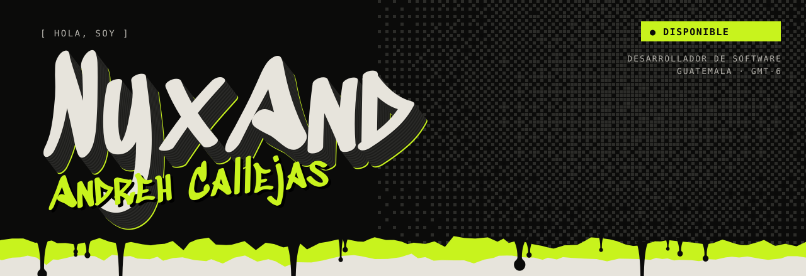

  
  <a href="https://github.com/AndrehhX/nyxand-portafolio">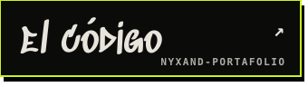</a>
  

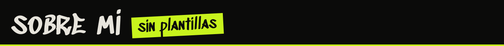

<table>
  <tr>
    <td width="34%" valign="top">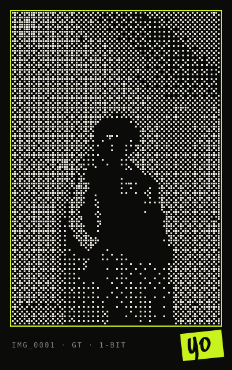</td>
    <td valign="top">

Soy **Dereck Andreh Callejas Ajin** — en internet, **NyxAnd**. Desarrollador de software en Guatemala y estudiante de Ingeniería en Ciencias de la Computación.

Construyo **plataformas web, apps Android y herramientas de escritorio**: desde streaming con watch parties en tiempo real hasta reescalado de video con shaders. Me obsesionan la tipografía, el movimiento y que las cosas no solo funcionen, sino que se sientan.

- Frontend con carácter: React, Next.js, WebGL y GSAP.
- Backend y datos con Supabase, Node.js, Java y MySQL.
- Nativo cuando hace falta: Kotlin en Android, Rust + Tauri en escritorio.
- Sin plantillas: cada interfaz, hecha a mano.

    </td>
  </tr>
</table>

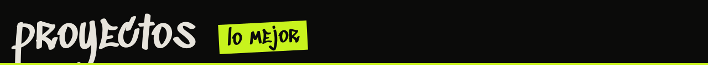

  <a href="https://github.com/AndrehhX/nyxand-portafolio">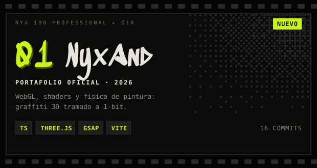</a>
  <a href="https://www.orunei.sbs">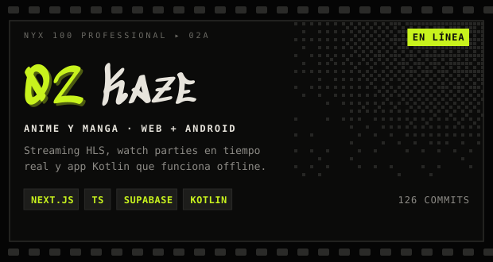</a>
  <a href="https://github.com/AndrehhX/orunei">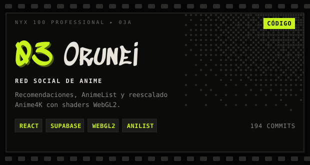</a>
  <a href="https://github.com/AndrehhX/Student-Organizer-Web">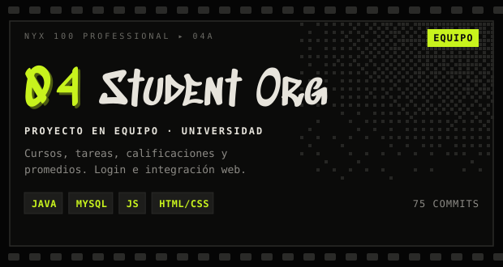</a>
  <a href="https://nyxand.site">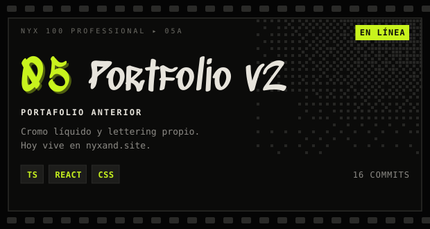</a>
  <a href="https://github.com/AndrehhX/NyxAnd-Portfolio">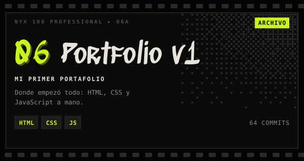</a>

| # | Proyecto | Qué es | Enlaces |
|---|---|---|---|
| 01 | **NyxAnd** | Mi portafolio oficial: graffiti 3D tramado a 1-bit, WebGL, shaders y física de pintura. | [código](https://github.com/AndrehhX/nyxand-portafolio) |
| 02 | **Kaze** | Plataforma de anime y manga: web en Next.js y app Android en Kotlin con una sola cuenta, streaming HLS y watch parties en tiempo real. | [en línea](https://www.orunei.sbs) · [APK](https://www.orunei.sbs/kaze.apk) · [código](https://github.com/AndrehhX/Kaze) |
| 03 | **Orunei** | Red social de anime: recomendaciones, AnimeList, perfiles y reescalado Anime4K con WebGL2. | [código](https://github.com/AndrehhX/orunei) |
| 04 | **Student Organizer** | Proyecto universitario en equipo con Java y MySQL. Mi aporte: login, integración web y dashboard. | [código](https://github.com/AndrehhX/Student-Organizer-Web) |
| 05 | **Portfolio v2** | Mi portafolio anterior, con cromo líquido y lettering propio. | [nyxand.site](https://nyxand.site) · [código](https://github.com/AndrehhX/NyxAnd-Portfolio-Principal) |
| 06 | **Portfolio v1** | Mi primer portafolio, en HTML, CSS y JavaScript. | [código](https://github.com/AndrehhX/NyxAnd-Portfolio) |

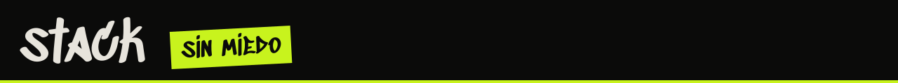

  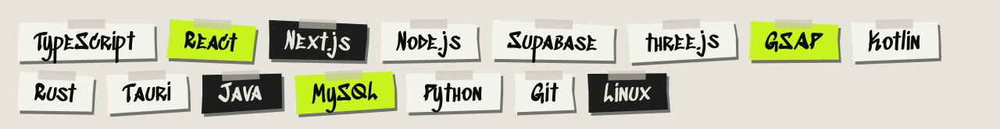

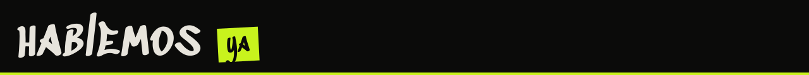

¿Tienes una idea loca? Estoy **disponible para proyectos**. Escríbeme a **[andrehcallex@gmail.com](mailto:andrehcallex@gmail.com)** o mira lo que hago en **[nyxand.site](https://nyxand.site)**.

  

Hecho a mano por Dereck Andreh Callejas Ajin — NyxAnd · Guatemala · 2026

