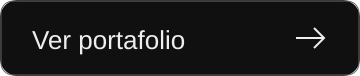
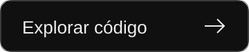
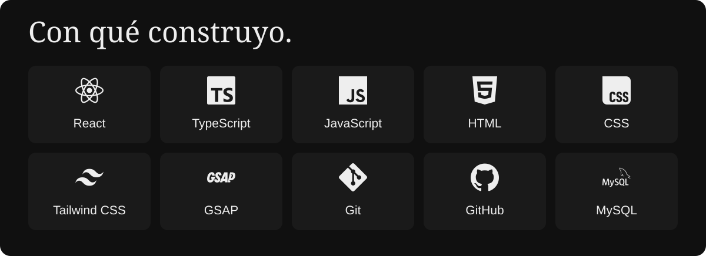
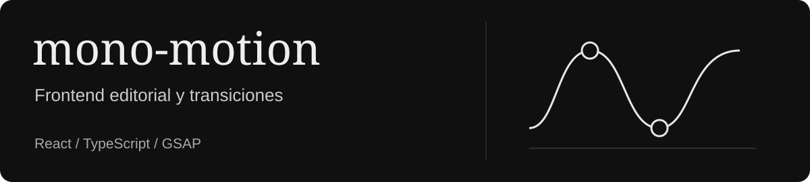
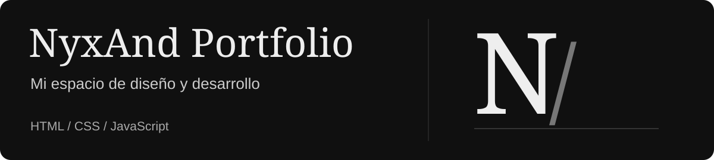
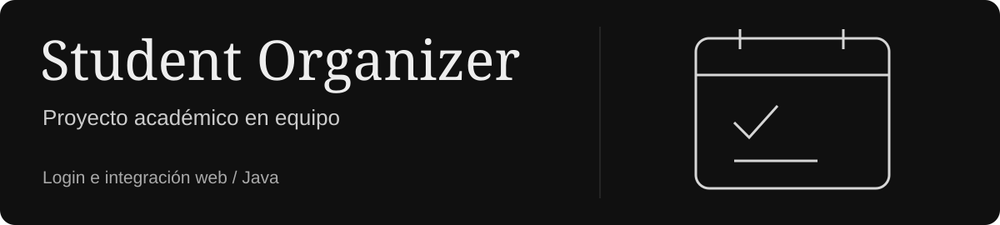
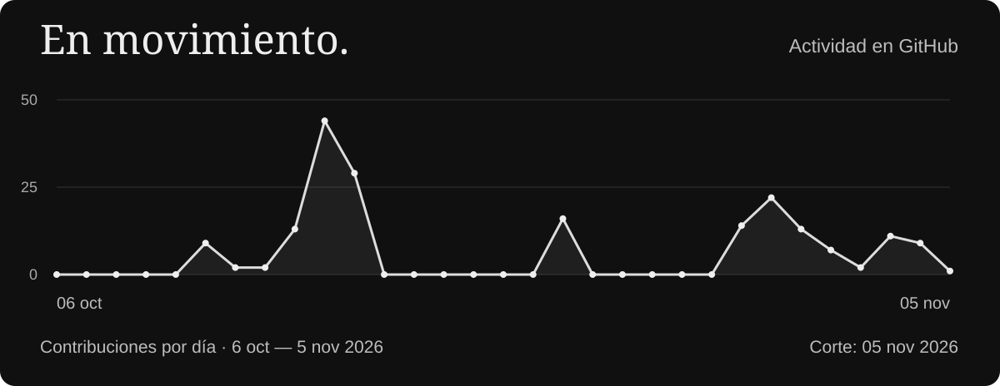

  

  
  &nbsp;
  

<h2 align="center">Diseño interfaces. Desarrollo experiencias web.</h2>

  

### Del diseño al navegador

Soy **Andreh Callejas**, desarrollador web enfocado en **frontend y diseño UI/UX**, y estudiante de Ingeniería en Ciencias de la Computación.

Me interesan la tipografía, la composición y cómo se siente una interfaz al usarla. Trabajo con **React, TypeScript y CSS**, layouts responsive y animaciones web para conectar el diseño con la implementación.

## Tecnologías y herramientas

  

**Frontend:** React · TypeScript · JavaScript · HTML · CSS · Tailwind CSS 
**Motion:** GSAP · **También trabajo con:** Java · MySQL · Git · GitHub

## Proyectos seleccionados

Exploración de composición, ritmo visual y movimiento, con vistas conectadas por transiciones e interacciones.

Mi espacio personal para presentar proyectos y formación, con una identidad monocromática e interfaces enfocadas en frontend.

Proyecto académico en equipo. **Mi aporte:** el flujo de inicio de sesión, su integración web y el trabajo visual en el dashboard.

## Actividad en GitHub

Corte del 5 de noviembre de 2026. La actividad actualizada está en el calendario de GitHub, más abajo.

  

  

