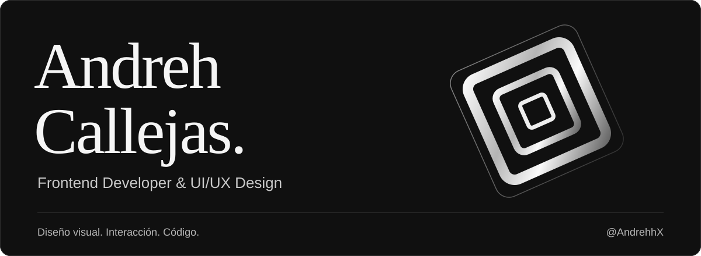

  

<h1 align="center">Diseño interfaces. Desarrollo experiencias web.</h1>

  Frontend, diseño UI/UX y atención al detalle. 
  De la composición visual a una interfaz que se puede usar.

  <a href="https://github.com/AndrehhX/NyxAnd-Portfolio">Mi portafolio</a> &nbsp; / &nbsp;
  <a href="https://github.com/AndrehhX?tab=repositories">Explorar repositorios</a>

## Sobre mí

Soy **Andreh Callejas**, desarrollador web enfocado en **frontend y diseño UI/UX**, y estudiante de Ingeniería en Ciencias de la Computación.

Me interesa cómo se ve, se entiende y se siente una interfaz. Trabajo con jerarquía visual, layouts responsive y animaciones web para conectar el diseño con la implementación.

## Mi enfoque

- **Diseño de interfaces:** tipografía, composición y sistemas visuales coherentes.
- **Desarrollo frontend:** interfaces web con React, TypeScript, HTML y CSS.
- **Experiencia de usuario:** navegación clara, adaptación a distintos tamaños de pantalla y detalles de interacción.

## Proyectos seleccionados

### [mono-motion](https://github.com/AndrehhX/mono-motion)

Exploración de frontend editorial con vistas conectadas por transiciones e interacciones. Un espacio para trabajar composición, ritmo visual y movimiento en la web.

`React` `TypeScript` `GSAP` `Tailwind CSS`

### [NyxAnd Portfolio](https://github.com/AndrehhX/NyxAnd-Portfolio)

Mi portafolio personal: una interfaz monocromática para presentar proyectos, formación y trabajo en desarrollo web.

`HTML` `CSS` `JavaScript`

### [Student Organizer Web](https://github.com/AndrehhX/Student-Organizer-Web)

Proyecto académico en equipo con Java y tecnologías web. **Mi aporte:** el flujo de inicio de sesión, su integración web y el trabajo visual en el dashboard.

`Java` `HTML` `CSS` `JavaScript` `MySQL`

## Tecnologías y herramientas

**Frontend** &nbsp; React · TypeScript · JavaScript · HTML · CSS · Tailwind CSS

**Motion** &nbsp; GSAP

**También trabajo con** &nbsp; Java · MySQL · Git · GitHub

---

  Tipografía, interacción y código. El detalle también es parte de la experiencia.

