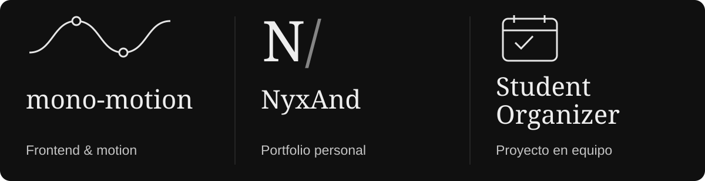

  

  
  &nbsp;
  

  

Soy **Andreh Callejas**, desarrollador web enfocado en **frontend y diseño UI/UX**, y estudiante de Ciencias de la Computación. Me interesan la tipografía, las interfaces responsive y el movimiento en la web.

  

## Proyectos seleccionados

  

- **[mono-motion](https://github.com/AndrehhX/mono-motion)** — React, TypeScript y GSAP.
- **[NyxAnd Portfolio](https://github.com/AndrehhX/NyxAnd-Portfolio)** — Diseño y desarrollo web.
- **[Student Organizer](https://github.com/AndrehhX/Student-Organizer-Web)** — Mi aporte: login, integración web y trabajo visual en el dashboard.
